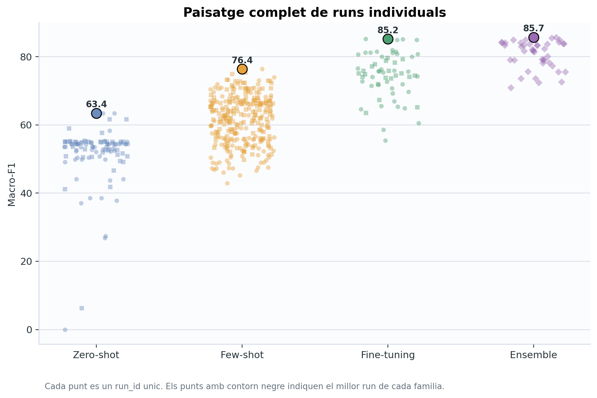
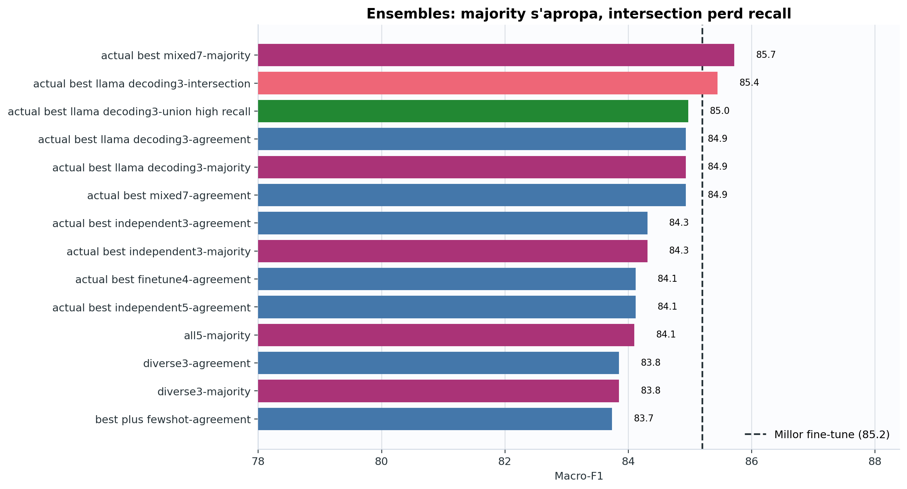
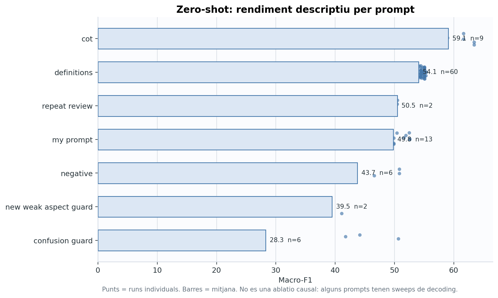
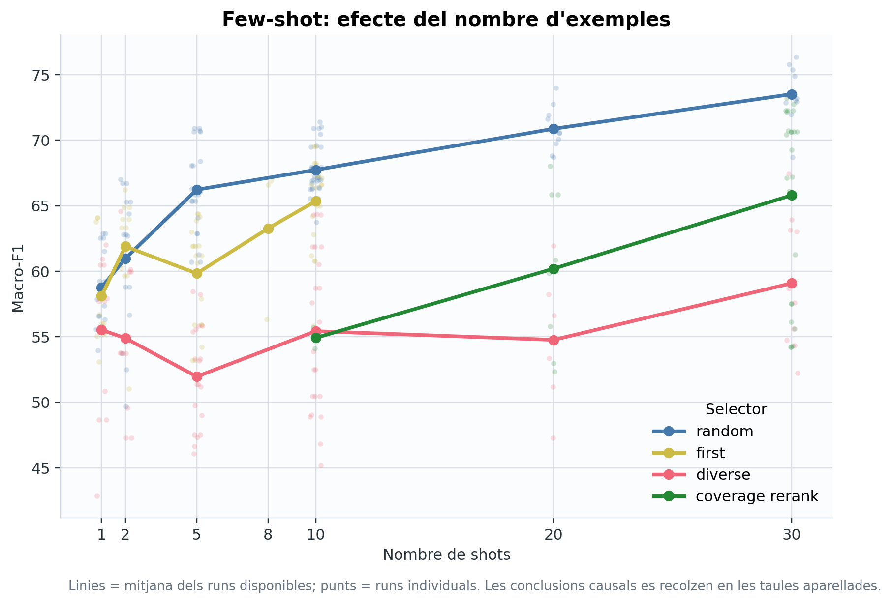
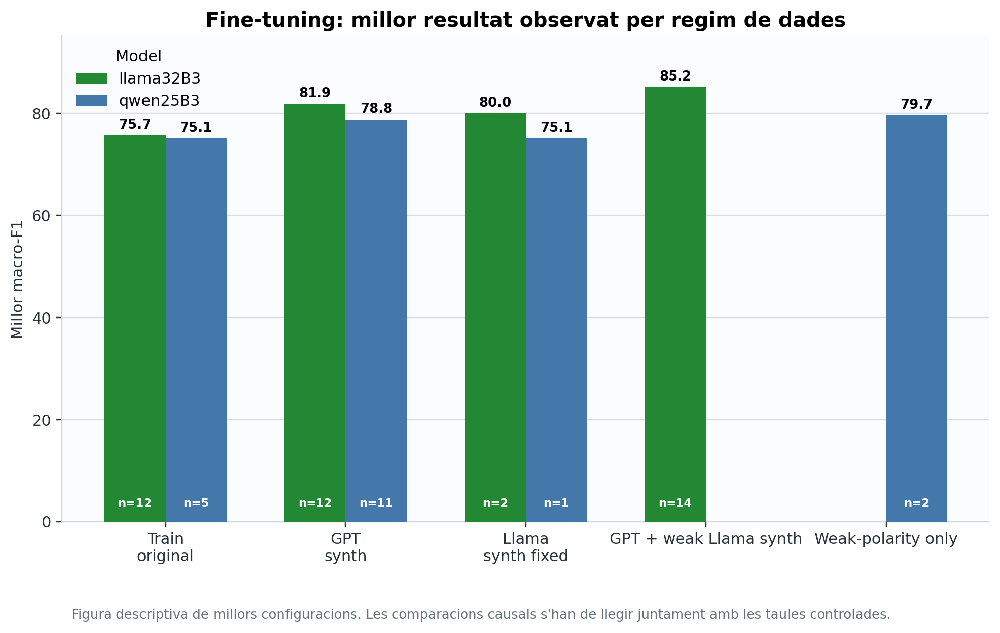
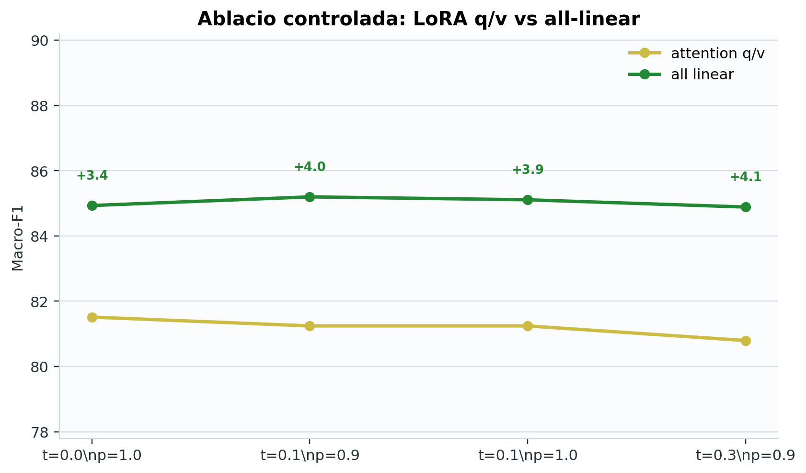
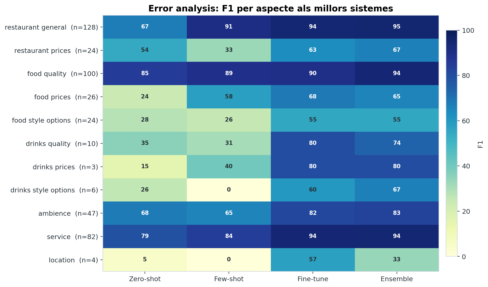
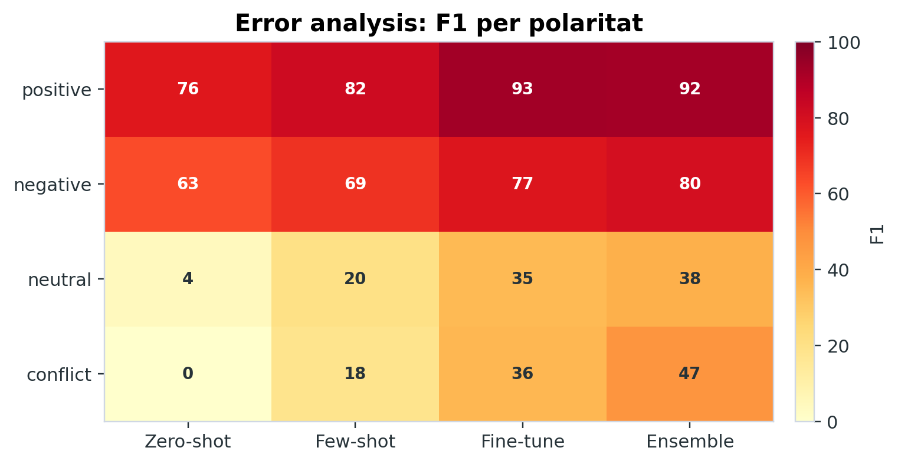

# ABSA With Small LLMs

Aspect-Based Sentiment Analysis experiments with small open LLMs, focused on
getting strong, reproducible results with **Llama 3.2 3B** and **Qwen 2.5 3B**.

The project covers the full assignment pipeline: zero-shot prompting, few-shot
prompting, synthetic data generation, LoRA/QLoRA fine-tuning, quantization,
decoding sweeps, ensemble voting, evaluation, and report-ready plots.

<p align="center">
  
</p>

## Headline Results

The strongest system is an ensemble over the best fine-tuned and few-shot
predictions. The best individual model is still a Llama 3.2 3B QLoRA adapter
trained with GPT synthetic data plus weak-aspect Llama synthetic data.

| Family | Best macro-F1 | Best micro-F1 | Notes |
|---|---:|---:|---|
| Zero-shot | 63.438 | 61.139 | Best prompt: CoT, Llama, no quantization |
| Few-shot | 76.358 | 76.307 | Best run: Llama + CoT + 30 random shots |
| Fine-tuning | 85.199 | 86.034 | Llama QLoRA, bf16, all-linear LoRA |
| Ensemble | **85.718** | **87.273** | Majority vote over the actual best models |

<p align="center">
  
</p>

## What This Repository Contains

```text
.
|-- configs/
|   |-- experiments/        # YAML configs for single runs and sweeps
|   |-- prompts/            # Zero-shot, few-shot, and generation prompts
|-- data/                   # ABSA train/devel/test data, when available
|-- scripts/
|   |-- run_experiment.py   # Run one YAML experiment
|   |-- make_sweep.py       # Expand a YAML matrix into JSONL rows
|   |-- run_sweep_row.py    # Run one row of a sweep
|   |-- summarize.py        # Build summary.csv/json/md from runs
|   |-- make_report_assets.py
|-- slurm/                  # Boada Slurm launchers
|-- src/                    # Core ABSA framework
|-- runs/                   # Local/generated run outputs
|-- boada/boada_runs/       # Copied-back Boada/Vast run outputs
|-- reports/
|   |-- summary.csv         # Main experiment table
|   |-- report_assets/      # Publication/report-ready figures and tables
|-- tests/                  # Parser/evaluator/sweep/ensemble tests
```

## Main Design Choices

- **Closed-list ABSA output**: predictions are JSON dictionaries such as
  `{"food_quality": "positive"}`.
- **Evaluation is pair-based**: exact scoring over `(aspect, polarity)` pairs.
- **Empty-gold examples are handled correctly**: the original assignment
  evaluator treated them poorly, so this framework reports both compatible and
  corrected metrics.
- **Fine-tuning masks prompt tokens**: loss is applied to assistant JSON output,
  not to the instruction/user prompt.
- **YAML-first experiments**: single runs and sweeps are defined in
  `configs/experiments`.
- **Report assets are regenerated from runs**: no manual spreadsheet wrangling
  is needed once experiments are copied back.

## Models

Reportable assignment models:

| Name | Default Boada path |
|---|---|
| `llama32B3` | `/scratch/nas/1/PDI/mml0/models/llama32B3/` |
| `qwen25B3` | `/scratch/nas/1/PDI/mml0/models/qwen25B3/` |

The registry also contains local smoke-test models such as `tiny-local` and
`qwen-small`. These are useful for checking code wiring, but they are marked as
non-reportable and should not be used for final conclusions.

## Quick Start

Install dependencies:

```bash
python -m venv .venv
source .venv/bin/activate
pip install -r requirements.txt
```

On Windows PowerShell:

```powershell
python -m venv .venv
.\.venv\Scripts\Activate.ps1
pip install -r requirements.txt
```

Run the tests:

```bash
python -m pytest tests/test_final_framework.py -q
```

## Running Experiments

Run one YAML config:

```bash
python scripts/run_experiment.py configs/experiments/zero_shot/single_llama.yaml
```

Expand a sweep:

```bash
python scripts/make_sweep.py \
  configs/experiments/final/ensemble_actual_best_models.yaml \
  --output artifacts/sweeps/ensemble_actual_best_models.jsonl
```

Run one sweep row locally:

```bash
python scripts/run_sweep_row.py artifacts/sweeps/ensemble_actual_best_models.jsonl --index 0
```

Run a single experiment on Boada:

```bash
sbatch slurm/single_run.sh configs/experiments/zero_shot/single_llama.yaml
```

Run a long sequential sweep on Boada:

```bash
sbatch slurm/long_sweep.sh artifacts/sweeps/final_sweep.jsonl
```

Outputs are written under structured run folders:

```text
runs/<task>/<run_id>/
|-- run.json
|-- predictions.jsonl
|-- predictions.assignment.json
|-- metrics.json
|-- errors.csv
|-- logs/
```

## Summaries And Report Assets

After experiments finish and remote runs are copied back, regenerate summaries:

```bash
python scripts/summarize.py --runs-dir boada/boada_runs --include-local --no-plots
python scripts/make_report_assets.py
```

Important outputs:

| File | Purpose |
|---|---|
| `reports/summary.csv` | Main experiment table, one row per run |
| `reports/summary_by_seed.csv` | Seed-aggregated view |
| `reports/report_assets/figures/` | Polished PNG/PDF figures |
| `reports/report_assets/tables/` | LaTeX-ready tables |
| `reports/report_assets/report_main_insertions.tex` | Main report snippets |
| `reports/report_assets/report_annex_insertions.tex` | Appendix snippets |
| `reports/report_assets/report_rewrite_notes.md` | Interpretation notes |

## Key Findings

### Zero-shot

CoT is the strongest zero-shot prompt, but it costs more generated tokens. The
`definitions` prompt is useful as a controlled decoding sweep rather than as a
simple prompt average.

<p align="center">
  
</p>

### Few-shot

More examples generally help. Random selection is surprisingly strong, while
overly dense selectors such as `diverse` and `coverage_rerank` can encourage
overprediction.

<p align="center">
  
</p>

### Fine-tuning

The best individual system is:

- model: `llama32B3`
- method: QLoRA, 4bit, bf16
- LoRA target: `all_linear`
- base data: `gpt5.5_1000/train_plus_synth`
- extra synthetic data: `synthetic_weak_aspects_600` generated with Llama
- decoding: temperature `0.1`, top-p `0.9`
- macro-F1: `85.199`

<p align="center">
  
</p>

The strongest controlled fine-tuning result is the LoRA target ablation:
all-linear LoRA consistently beats attention q/v LoRA.

<p align="center">
  
</p>

### Ensembles

The final best system is `actual_best_mixed7-majority-repairnone`, a majority
vote over strong Llama/Qwen fine-tuned runs plus the best few-shot run.

This improves over the best single fine-tune:

```text
Best fine-tune: 85.199 macro-F1
Best ensemble:  85.718 macro-F1
```

## Error Analysis

Fine-tuning helps most on rare or difficult aspects, but the weakest classes
remain hard because devel support is small. The hardest polarities are still
`neutral` and `conflict`.

<p align="center">
  
</p>

<p align="center">
  
</p>

## Synthetic Data

Synthetic generation is framed as the inverse task: sample an opinion dictionary
first, then ask a model to generate a review that expresses those aspects and
polarities.

The final synthetic pipeline includes:

- language control: English/Spanish distribution is explicit;
- weak-aspect targeting: focus on low-performing aspects;
- weak-polarity targeting: boost `neutral` and `conflict`;
- manual quality checks;
- optional round-trip extraction checks.

The best fine-tuned model does **not** use only Llama synthetic data. It combines
GPT synthetic data with a weak-aspect Llama-generated synthetic set.

## Reproducibility Notes

- Greedy decoding runs are effectively deterministic, so many are single-seed.
- Some decoding and few-shot sweeps include seeds `13`, `42`, and `101`.
- The best fine-tunes are expensive and not all are replicated with multiple
  seeds.
- Descriptive plots show the full explored landscape. For causal claims, use the
  controlled tables in `reports/report_assets/tables`.
- Alias repair is implemented, but final best results use `repair_policy: none`.

## Useful Configs

| Config | Purpose |
|---|---|
| `configs/experiments/zero_shot/single_llama.yaml` | Single zero-shot run |
| `configs/experiments/final/few_shot_required_final.yaml` | Required few-shot sweep |
| `configs/experiments/final/synthetic_weak_aspects_600.yaml` | Weak aspect/polarity synthetic data |
| `configs/experiments/final/finetune_lora_target_modules.yaml` | LoRA target ablation |
| `configs/experiments/final/finetune_qwen_required.yaml` | Qwen fine-tuning coverage |
| `configs/experiments/final/ensemble_actual_best_models.yaml` | Final actual-best ensembles |

## Final Report

The final PDF is available as:

```text
PauHidalgo_JaumeMora_ABSA_with_llms.pdf
```

